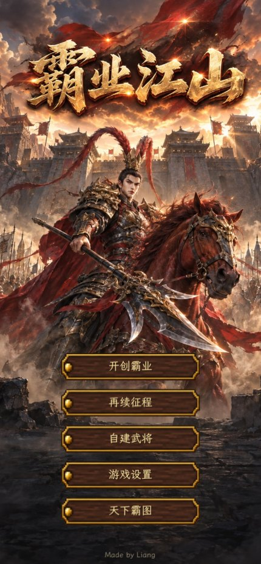
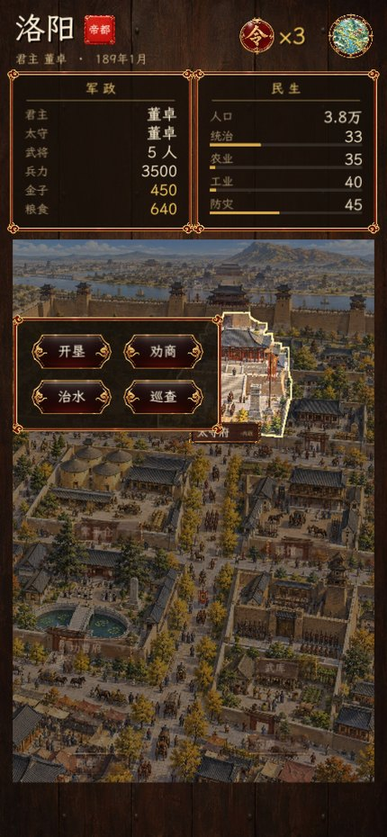
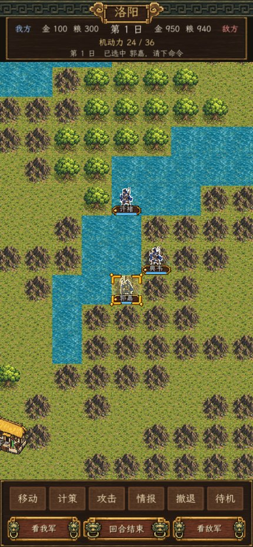
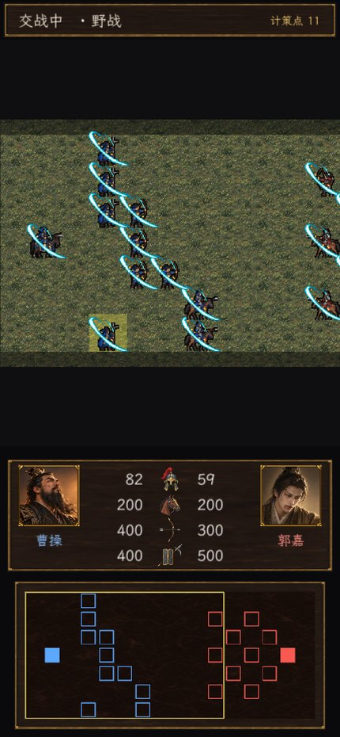
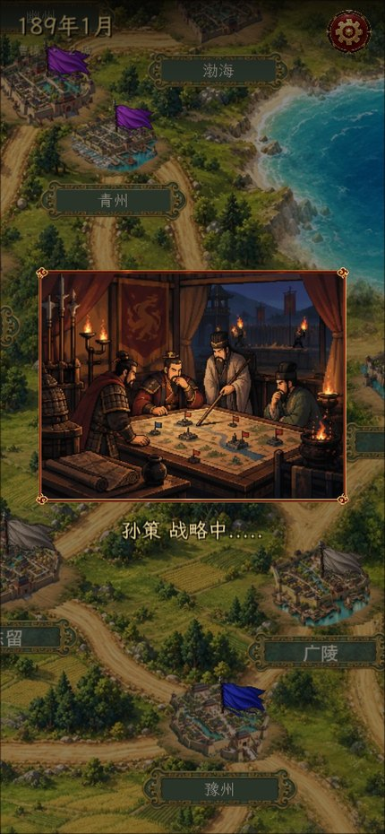
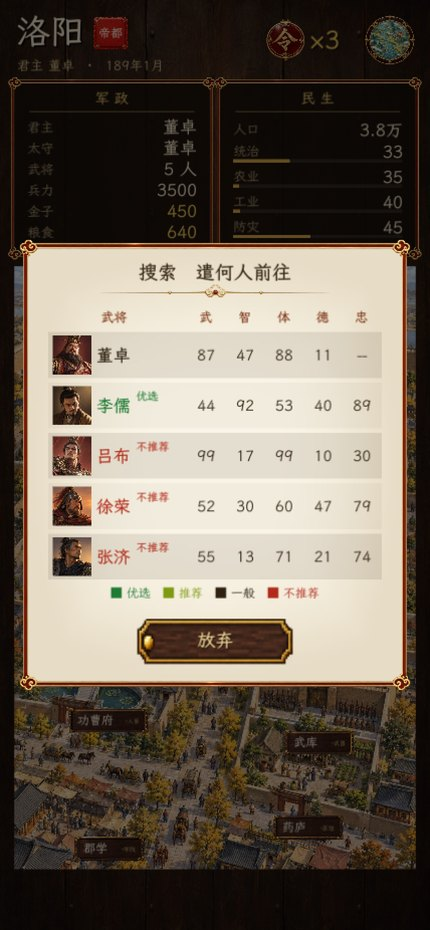
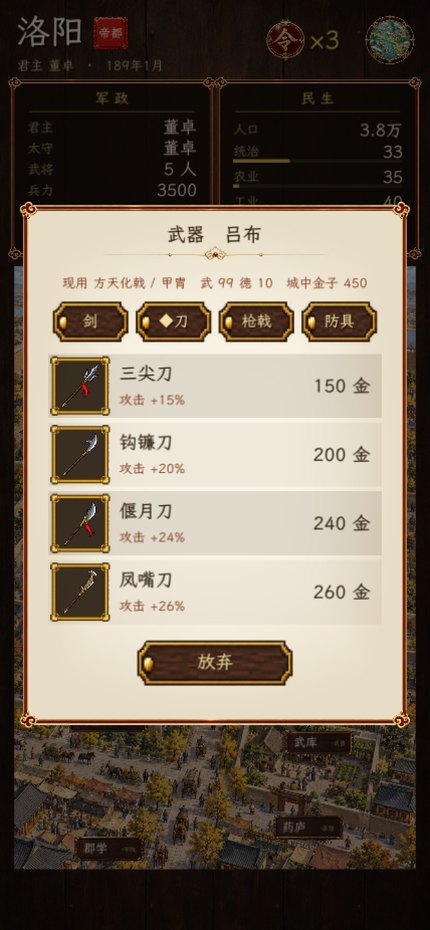
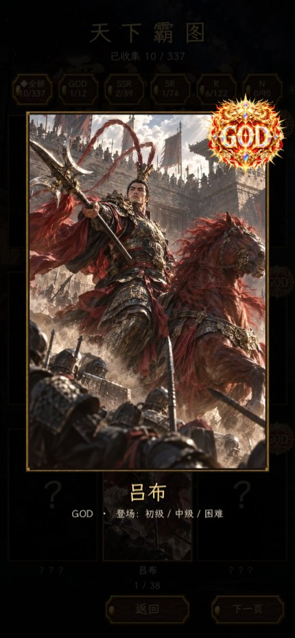

# 三国志霸王的大陆 · 复刻

把 J2ME 老游戏《三国志霸王的大陆 V3.2.2》复刻成竖屏手机游戏，成品叫《霸业江山》。
原版逻辑从字节码反编译还原，美术全部用 AI 重绘。

> 私有仓库。包含反编译的原版代码与解包的原版素材，仅供个人研究，请勿公开。

## 画面

<table>
<tr>
<td width="25%"></td>
<td width="25%"></td>
<td width="25%"></td>
<td width="25%"></td>
</tr>
<tr>
<td align="center">主界面</td>
<td align="center">城内·太守府指令</td>
<td align="center">战棋层·移动与计策</td>
<td align="center">阵型战·野战</td>
</tr>
<tr>
<td></td>
<td></td>
<td></td>
<td></td>
</tr>
<tr>
<td align="center">大地图·势力与事件</td>
<td align="center">人事·搜索贤才</td>
<td align="center">集市·购置兵器</td>
<td align="center">天下霸图·武将图鉴</td>
</tr>
</table>

原图是 1284×2778 的 App Store 截图，在 `assets/store/`。

## 下载

成品包在 [Releases](../../releases)：macOS、Windows、Android APK、未签名 iOS ipa 四个平台。
iOS 那个未签名，要自己用 AltStore / Sideloadly 签了再装；
Android 用的是 Unity 的 debug 密钥，能直接装但不能上 Google Play。

## 目录

| 路径 | 内容 |
|---|---|
| `docs/` | 反编译还原的游戏逻辑、画面结构、地图与城内视图的做法 |
| `decompiled/` | CFR 反编译出的 4 个 class |
| `extract/` | 解包出的数据表、原版素材、地图管线脚本 |
| `image-studio/` | 生图平台源码（部署在 sg.areu.pro） |
| `assets/` | 生图平台产出的全部素材，见 `docs/ASSETS.md` |
| `unity/SangoCityView/` | Unity 原型：主地图 + 城内视图，能跑能点 |
| `samples/` | 一路上的验证截图 |

## 从这里接着做

```bash
git clone https://github.com/iam567/bwdl-reverse.git
cd bwdl-reverse/unity/SangoCityView
cp "/Library/Fonts/Arial Unicode.ttf" Assets/Fonts/CJK.ttf      # 字体没进仓库
/Applications/Unity/Hub/Editor/6000.4.1f1/Unity.app/Contents/MacOS/Unity \
  -batchmode -projectPath "$PWD" -executeMethod Builder.BuildMac -logFile "$PWD/build.log" -quit
open Build/SangoCityView.app
```

## 文档

| 文件 | 内容 |
|---|---|
| `docs/GAME_LOGIC.md` | 战斗/人事/内政的公式，字段语义，哪些已验证哪些还没 |
| `docs/UI_SCREENS.md` | 28 个画面的绘制入口，城内管理的完整构图与 24 条指令分派 |
| `docs/CITY_GRAPH.md` | 36 城 52 条边的连通关系 |
| `docs/MAP_ASSETS.md` | 大地图怎么生成、拼接、贴城池、插旗 |
| `docs/CITY_VIEW.md` | 城内视图：整图生成 + 语义蒙版 + 点击判定 |
| `docs/ASSETS.md` | 素材目录，PNG/JPEG 的取舍 |
| `docs/DATA_FORMAT.md` | `.jg` 格式（改了头 16 字节的 PNG）与数据表 |

## 进度

**已完成**：原版数据全解、核心公式还原、36 城连通图、
一套 460 张的人物立绘与头像、两级大地图与人工校准的城池坐标、
52 条行军路径、10 面势力旗、洛阳一座城的城内视图（含点击蒙版）、
Unity 可运行原型。

**下一步**：其余 35 座城的城内图与蒙版、行军动画、战棋战场。
